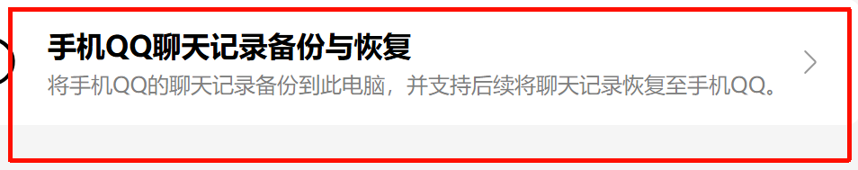

# 恢复手机 QQ 的 Windows 备份

先问清用户要哪次备份、哪些会话，以及要原始数据库还是可阅读的网页。若已有备份，直接从识别文件开始。手机可翻阅聊天、电脑能列出备份、附件能导出，是三件要分别验证的事。

## 1. 从手机备份到电脑

手机和 Windows QQ 登录备份对应的账号。在**电脑 QQ** 操作以下四步。图片只截取所需控件。

1. 点主窗口左下角的菜单。

   
2. 点「聊天记录管理」。

   
3. 点「手机QQ聊天记录备份与恢复」。

   
4. 点「新增备份」，按两端提示连接手机、确认会话并等待传输完成。

   

回到「这台电脑上的备份」核对账号、时间和会话数。按 QQ 实际设置找到对应的 `Tencent Files\<账号>\MsgBackup`。如果某层目录只含资源子目录，继续往下找。保留整个备份批次的目录结构，外置媒体可能与数据库分开存放。

## 2. 获取明文数据库

识别 `SQLite header 3\0` 且偏移 32 为 `MSG0` 的容器。大小、文件名、数据库个数在不同备份中可以变化。NTQQ 日常使用的消息库、旧版 Msg3.0.db 和聊天界面的截图需要各自的处理流程。

按[运行手册](references/windows.md)准备工作副本、核对组件指纹。仅在用户已同意临时附加到正在登录的 QQ 后，捕获备份回调。用候选密钥对各库实际查询表结构；已持有对应的本地已验证密钥可直接进入离线解密。密钥、原始备份、聊天正文和导出的媒体都放在仓库外的私人目录。

对每个工作副本离线 rekey。两个文件头符合预期后才剥离前 1024 字节，使用标准 SQLite 对每个结果做完整性检查。报告发现、解密、通过校验的库数。任一库未通过，只报告已验证的部分。

## 3. 还原私聊和媒体

按[导出手册](references/export.md)识别消息表与资源分片，对每个选中的私聊表生成独立 HTML。每条消息显示发送方、完整日期和时间。保留原消息顺序、引用、动图、通话状态和附件缺失占位。需要其他聊天类型或未知消息字段时，先检查实际 schema，再扩展解析。

交付时列明消息条数、起止时间、媒体匹配数与未匹配数。抽查跨日消息、图片放大、语音和视频是否确实开始播放。只向用户交付其请求的数据库或离线包，发布或分享本 skill 时只使用源代码和裁过的操作配图。
